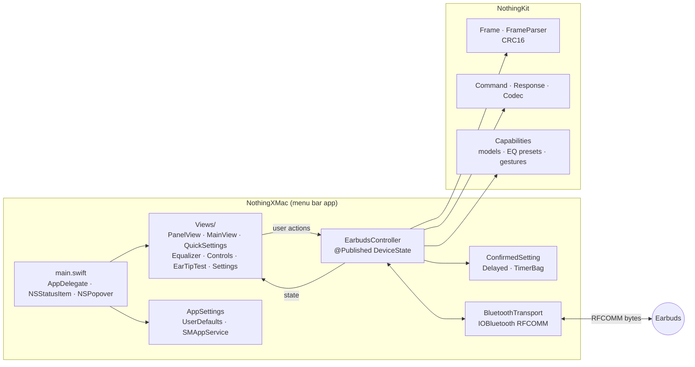
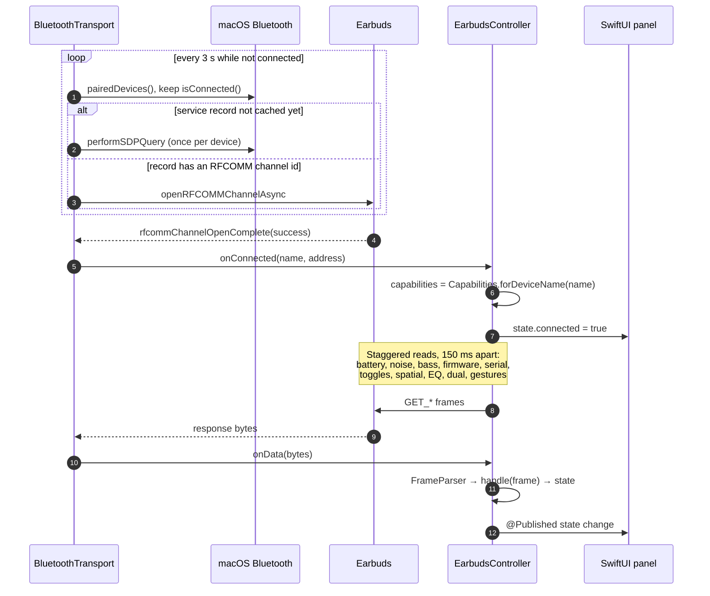
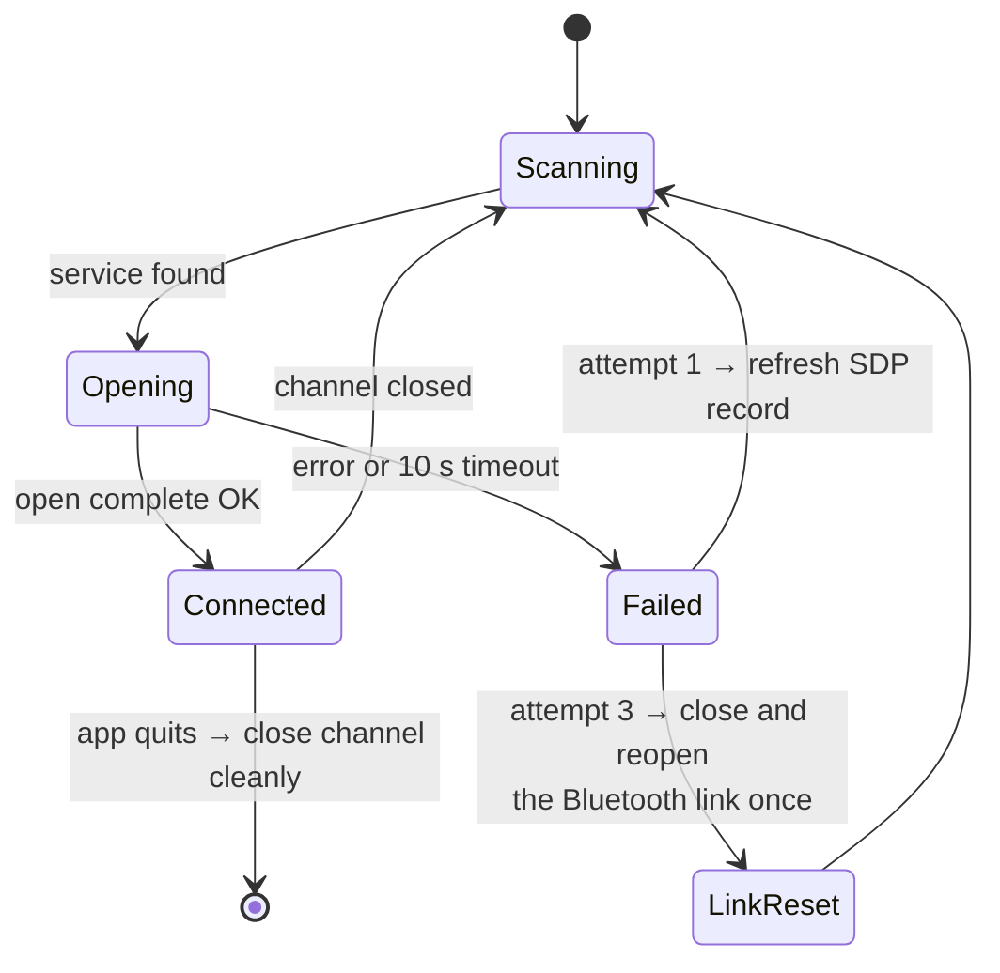
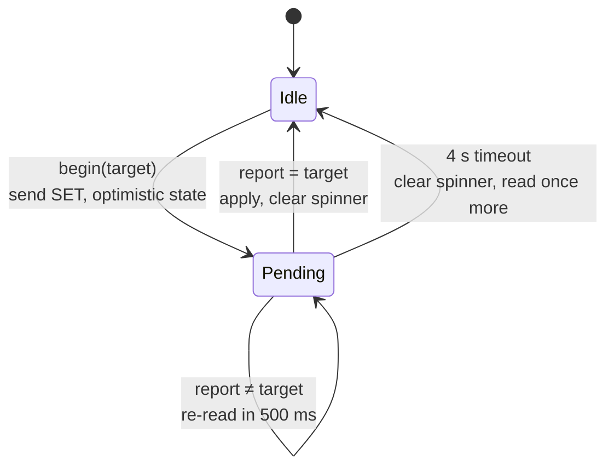
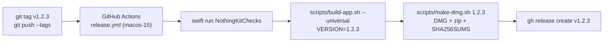

# Architecture

Nothing X Mac is a single native process: an AppKit status item that hosts a
SwiftUI panel, talking to the earbuds over Bluetooth Classic (RFCOMM) through
IOBluetooth. There is no helper process, no web view and no network access.

## Modules

The Swift package has three targets.

| Target | Kind | What it does |
| --- | --- | --- |
| `NothingKit` | library | The earbud protocol: packet framing, CRC, command ids, payload encoders and decoders, and per-model capabilities. Pure Swift with no UI or Bluetooth, so it's easy to test. |
| `NothingXMac` | app | Bluetooth transport, device state, settings and the SwiftUI panel. |
| `NothingKitChecks` | tool | Self-checks for `NothingKit` (`swift run NothingKitChecks`). |



## Source map

```
Sources/NothingKit/
  Frame.swift              Frame encoder, CRC-16/MODBUS, streaming FrameParser
  Commands.swift           Command and response ids, Codec (all payload formats), value types
  Models.swift             Per-model capability table, EQ preset lists, gesture layouts
  LowBattery.swift         When to alert: 20% / 10% thresholds, re-arm after charging
Sources/NothingXMac/
  main.swift               App entry, status item, popover, right-click menu
  BluetoothTransport.swift Finds the buds, opens and recovers the RFCOMM channel, relays bytes
  EarbudsController.swift  All device state and every setter; routes incoming frames
  ConfirmedSetting.swift   "Wait until the buds confirm" helper plus timer utilities
  DeviceState.swift        Plain value types the UI renders
  AppSettings.swift        Menu bar battery mode, low battery alerts, saved EQs, Open at Login
  LowBatteryNotifier.swift Posts notifications; rules live in NothingKit/LowBattery.swift
  DebugSnapshots.swift     Debug only: renders every page to PNG (NXM_SNAPSHOT)
  DebugAnimation.swift     Debug only: renders the README walkthrough GIFs (NXM_ANIMATE)
  Views/                   One file per panel page plus shared components
    Theme.swift            Design tokens, SF Pro type ramp, Liquid Glass surfaces (glassEffect on
                           macOS 26+, material fallback before), accent (brand red or system)
    SettingsView.swift     In-panel preferences, keyboard shortcuts, version and Quit
    Earbud.swift           Earbud mark: AirPods Pro SF Symbols with fallbacks (menu bar image and SwiftUI glyph)
scripts/make-icon.swift    Draws the app icon (Resources/AppIcon.icns, docs/icon.png)
```

## How a connection comes up

`BluetoothTransport` scans every 3 seconds for a paired device that is
currently connected and offers the Nothing control service (UUID
`aeac4a03-dff5-498f-843a-34487cf133eb`). It opens an RFCOMM channel to that
service asynchronously, so the UI never blocks.



### Recovering a stuck channel

Earbuds often keep a channel open from an earlier session that never closed
it, and then refuse new ones. The transport recovers in two steps:



On quit the app closes the channel explicitly. That's what lets the earbuds
accept the next launch's connection right away.

## How a setting change works

The earbuds often report the old value for a moment after a change. Each
setting is wrapped in a `ConfirmedSetting`, which makes the UI respond
instantly and then wait for the earbuds to agree:

1. The UI calls a setter, e.g. `setNoiseMode(.transparency)`.
2. The controller sends the `SET_*` frame, updates state optimistically and
   marks it **pending**. The UI shows a spinner and ignores further taps on that control.
3. After 400 ms it reads the value back. Reports that don't match the target are
   ignored, and it asks again every 500 ms.
4. A matching report clears the pending flag. If no match arrives within 4 s,
   the pending flag is dropped and the next report is trusted.



Some settings use a different approach:

- **Custom EQ** sliders are debounced (120 ms) and send the full 3-band set.
  For 1 s after a local change, incoming EQ reports are ignored so a reply
  that crossed the drag can't snap the slider back.
- **Gestures** are read back as a whole list 400 ms after a change.
- **Dual connection** device connect/disconnect waits for the buds' device
  event, with a 15 s timeout before refreshing the list.
- **Find Buds** stops by itself after 30 s.

## Models and capabilities

Every model advertises a product name over Bluetooth (e.g. "CMF Buds 2 Plus").
`Capabilities.forDeviceName` matches it against a table, longest name first, so
"CMF Buds 2 Plus" wins over "CMF Buds". The result tells the UI what to show:

- noise modes and intensity levels
- Bass Enhance steps (5, 3 or none)
- in-ear detection, low latency and Personal Sound backend (Mimi or Audiodo)
- equalizer command family (Nothing "EQ" or CMF "listening mode"), presets,
  whether custom EQ exists, and the treble band frequency
- spatial audio modes (from a bitmask)
- dual connection, and whether switching it restarts the buds
- the gesture layout, ear tip test support, and the Find Buds style

Unknown names fall back to a sensible default. Where one name covers two
hardware revisions, the first bass report corrects the guess (wire level 5
only exists on 3-step models).

## Low battery alerts

`LowBatteryNotifier` watches battery reports and asks `LowBatteryTracker`
(in NothingKit, covered by the self-checks) whether to alert. Each part (left,
right, case, or a single headphone battery) alerts once at 20% and once at
10%. It re-arms after charging, or once the level is back 5+ points above the
last alert, so a battery hovering at 19–21% never spams you. Parts that cross a
threshold in the same report share one notification. Permission is requested
the first time earbuds connect, not at launch.

## UI

- `NSStatusItem` shows the AirPods Pro SF Symbol (`airpods.pro.gen3`, with older fallbacks) as a template image. Its four
  states (disconnected, connecting, connected, low battery ≤20%) change its
  opacity, and low adds a small dot badge. Optional battery text (and the case
  level, behind the AirPods Pro case symbol) sits next to it. Left click toggles an `NSPopover`; right click shows the app menu.
- Battery levels are SF Pro numerals under ring gauges. Colors, type and the
  Liquid Glass surfaces live in `Views/Theme.swift`; the accent is
  brand red unless **Use System Accent Color** is on.
- The popover hosts `PanelView` in an `NSHostingController` with
  `sizingOptions = .preferredContentSize`, so its height follows the content.
- `PanelNavigation.page` drives the sub-pages, which slide in from the right.
  Esc goes back, and closing the popover always returns to the main page.
- Views use a tiny `Local<T>` observable instead of `@State`. In the current
  SDK `@State` is a macro whose compiler plugin ships only with Xcode, and this
  keeps the project buildable with just the Command Line Tools.

## Build and release



`build-app.sh` runs `swift build -c release`, assembles the `.app` (binary,
Info.plist, icon) and ad-hoc signs it. Info.plist is also linked into the
executable's `__TEXT,__info_plist` section, so a bare `swift run` (or Run in
Xcode) has the Bluetooth usage string too. Without it, macOS terminates the
process on first Bluetooth access.
